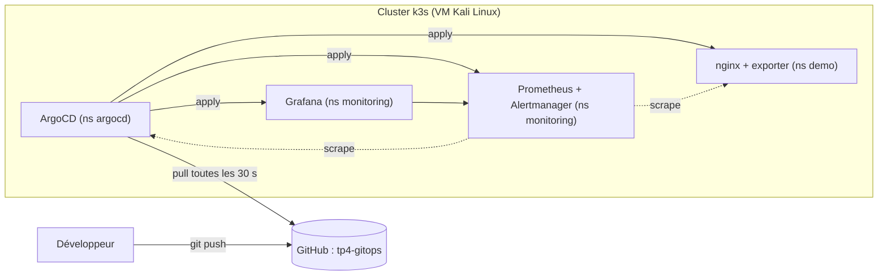

# TP4 : GitOps, ArgoCD et Observabilité pour le Continuous Deployment

> GitOps • Continuous Deployment • Kubernetes (k3s) • ArgoCD • Prometheus • Grafana

## 1. Présentation

Ce dépôt est la **source unique de vérité** (Single Source of Truth) d'un pipeline de Continuous Deployment GitOps :

- **Partie A** : ArgoCD déploie une application NGINX depuis Git (Automated Sync + Self-Healing).
- **Partie B** : Prometheus et Grafana supervisent le control plane ArgoCD et les workloads, avec alerting.

Tout est déclaratif et piloté par Git : l'application, ArgoCD (applications), la stack de monitoring, les ServiceMonitors, les règles d'alerte et le dashboard Grafana.

## 2. Architecture globale



**Flux de travail**

1. Le développeur modifie les manifestes et pousse sur `main`.
2. ArgoCD interroge Git (pull), compare l'état désiré à l'état réel du cluster et synchronise automatiquement.
3. `selfHeal` annule toute modification manuelle ; `prune` supprime ce qui a été retiré de Git.
4. Prometheus collecte les métriques via des ServiceMonitors ; Grafana les affiche ; les règles d'alerte sont évaluées par Prometheus et envoyées à Alertmanager.
5. La correction d'une anomalie passe par Git (`git revert`), de façon auditable.

**Composants et versions**

| Composant | Version | Rôle |
|---|---|---|
| k3s | v1.37.2+k3s1 | Cluster Kubernetes léger (mono-nœud) |
| ArgoCD | v3.6.2 | Moteur GitOps (pull) |
| kube-prometheus-stack (Helm) | 65.5.0 | Prometheus, Alertmanager, Grafana, kube-state-metrics |
| Grafana | 11.2.2 | Dashboards |
| NGINX | 1.26.2 puis 1.27.2 | Application de démonstration |
| nginx-prometheus-exporter | 1.3.0 | Métriques applicatives (sidecar) |
| Kustomize | intégré à kubectl | Base et overlays |

## 3. Structure du dépôt

```
tp4-gitops/
├── README.md
├── bootstrap/
│   └── root-app.yaml              # Application racine (App-of-Apps)
├── argocd-apps/
│   ├── nginx-dev.yaml             # Application NGINX (Automated Sync + selfHeal)
│   ├── monitoring.yaml            # kube-prometheus-stack (Helm, valeurs allégées)
│   └── monitoring-config.yaml     # ServiceMonitors, alertes, dashboard
├── nginx/
│   ├── base/                      # deployment, service, kustomization, default.conf
│   └── overlays/
│       ├── dev/                   # namespace demo, 2 réplicas, image épinglée
│       └── prod/                  # namespace demo-prod, 3 réplicas
└── monitoring/
    └── config/
        ├── servicemonitors.yaml   # ArgoCD (3) + application nginx
        ├── alerts.yaml            # PrometheusRule (3 alertes)
        ├── dashboard.json         # Export JSON du dashboard Grafana
        └── kustomization.yaml     # Génère la ConfigMap du dashboard
```

## 4. Choix techniques

| Choix | Justification |
|---|---|
| **k3s** (Traefik désactivé) | Kubernetes complet en un seul binaire, adapté à une VM de 4 vCPU / 8 Go. |
| **Kustomize** (base + overlays) | Approche déclarative sans templating : l'overlay ne porte que les différences (namespace, réplicas, tag). |
| `configMapGenerator` | Le hash dans le nom de la ConfigMap relance les pods quand la configuration change. |
| **Tags d'image épinglés** | Reproductibilité : jamais `latest`. |
| `progressDeadlineSeconds: 60` | Un déploiement en échec passe rapidement en *Degraded* (600 s par défaut). |
| Requests / limits sur chaque conteneur | Maîtrise des ressources et base pour la supervision. |
| **Sidecar nginx-prometheus-exporter** | Expose les métriques applicatives (`/metrics`, port 9113) lues sur `stub_status`. |
| **App-of-Apps** | ArgoCD déploie aussi la stack de monitoring : tout l'état est dans Git. |
| Application racine sans `selfHeal` | Elle ne réactive pas l'Auto-Sync d'`nginx-dev` pendant le rollback du scénario 4 (`ignoreDifferences` sur `syncPolicy`). |
| kube-prometheus-stack allégé | Composants non scrapables sur k3s désactivés (etcd, scheduler, controller-manager, kube-proxy, node-exporter), rétention 2 jours. |
| `ServerSideApply=true` | Nécessaire pour les CRD volumineux de la stack. |
| Dashboard en ConfigMap (label `grafana_dashboard`) | Chargé automatiquement par le sidecar de Grafana depuis Git. |
| Polling Git à 30 s | Détection rapide pour la démonstration (3 min par défaut). |

## 5. Reproduire l'environnement

```bash
# 1. Kubernetes léger (k3s, sans Traefik)
curl -sfL https://get.k3s.io | INSTALL_K3S_EXEC="--disable traefik --write-kubeconfig-mode 644" sh -
mkdir -p ~/.kube && cp /etc/rancher/k3s/k3s.yaml ~/.kube/config && export KUBECONFIG=~/.kube/config

# 2. ArgoCD
kubectl create namespace argocd
kubectl apply -n argocd --server-side --force-conflicts \
  -f https://raw.githubusercontent.com/argoproj/argo-cd/stable/manifests/install.yaml

# 3. Polling Git de 30 s (pour la démonstration)
kubectl -n argocd patch configmap argocd-cm --type merge -p '{"data":{"timeout.reconciliation":"30s"}}'
kubectl -n argocd rollout restart statefulset argocd-application-controller
kubectl -n argocd rollout restart deployment argocd-repo-server

# 4. App-of-Apps : ArgoCD déploie nginx-dev, monitoring et monitoring-config
kubectl apply -f bootstrap/root-app.yaml
```

**Accès aux interfaces (port-forward)**

| Service | Commande | URL |
|---|---|---|
| ArgoCD | `kubectl -n argocd port-forward svc/argocd-server 8080:443` | https://localhost:8080 |
| Grafana | `kubectl -n monitoring port-forward svc/monitoring-grafana 3001:80` | http://localhost:3001 |
| Prometheus | `kubectl -n monitoring port-forward svc/monitoring-kube-prometheus-prometheus 9090:9090` | http://localhost:9090 |
| Alertmanager | `kubectl -n monitoring port-forward svc/monitoring-kube-prometheus-alertmanager 9093:9093` | http://localhost:9093 |
| NGINX | `kubectl -n demo port-forward svc/nginx-demo 8081:80` | http://localhost:8081 |

Mot de passe ArgoCD : `kubectl -n argocd get secret argocd-initial-admin-secret -o jsonpath="{.data.password}" | base64 -d`.

## 6. Partie A : scénarios de démonstration

| # | Scénario | Action | Résultat |
|---|---|---|---|
| 1 | Déploiement continu | Git : 2 vers 4 réplicas, image 1.26.2 vers 1.27.2 | ArgoCD synchronise seul (rolling update), sans `kubectl apply` |
| 2 | Drift et self-healing | `kubectl delete deployment` puis `kubectl scale` | ArgoCD recrée la ressource et rétablit la valeur de Git |
| 3 | Synced vs Health | Git : tag d'image inexistant | **Synced** (conforme à Git) mais **Degraded** (`ErrImagePull`) |
| 4 | Historique et rollback | History and Rollback dans l'UI | Rollback refusé si l'Auto-Sync est actif : on le désactive, on revient en arrière, puis on corrige dans Git et on le réactive |

## 7. Partie B : observabilité

### 7.1 Collecte (ServiceMonitors)

| ServiceMonitor | Cible | Namespace |
|---|---|---|
| `argocd-metrics` | Application controller | argocd |
| `argocd-server-metrics` | API server | argocd |
| `argocd-repo-server-metrics` | Repo server (appels Git) | argocd |
| `nginx-demo` | Exporter NGINX (port `metrics`) | demo |

Métriques clés : `argocd_app_info` (labels `sync_status`, `health_status`), `argocd_app_sync_total`, `argocd_git_request_total`, `kube_deployment_*` et `kube_pod_container_status_*` (kube-state-metrics), `container_cpu_usage_seconds_total` et `container_memory_working_set_bytes` (cAdvisor), `nginx_http_requests_total` et `nginx_connections_active` (exporter).

### 7.2 Dashboard Grafana « TP4 GitOps Overview » et requêtes PromQL

Source de données : Prometheus (provisionnée par le chart). Le dashboard (14 panels) est organisé en 5 sections : *Alerting & Incident Monitoring*, *Pipeline GitOps*, *Détail des applications et activité Git*, *Workloads Kubernetes*, *Application nginx*.

| Panel | Requête PromQL | Rôle |
|---|---|---|
| Apps par Sync Status | `sum by (sync_status) (argocd_app_info)` | Conformité à Git (Synced / OutOfSync) |
| Apps par Health Status | `sum by (health_status) (argocd_app_info)` | Santé réelle (Healthy / Progressing / Degraded) |
| Synchronisations ArgoCD (A) | `sum by (name) (round(increase(argocd_app_sync_total[5m]))) or sum by (name) (argocd_app_info) * 0` | Syncs par application (0 si aucun sync récent) |
| Synchronisations ArgoCD (B) | `sum(increase(argocd_app_sync_total{phase!="Succeeded"}[5m])) or vector(0)` | Syncs en échec |
| État par application | `argocd_app_info` (table, instant) | Application, Health, Sync, Auto-Sync |
| Appels Git ArgoCD | `sum by (request_type) (rate(argocd_git_request_total[5m]))` | `ls-remote` (polling) et `fetch` (nouveau commit) |
| Pods Desired | `sum(kube_deployment_spec_replicas{namespace="demo",deployment="nginx-demo"})` | Réplicas voulus |
| Pods Available | `sum(kube_deployment_status_replicas_available{namespace="demo",deployment="nginx-demo"})` | Réplicas disponibles |
| Pods Unavailable | `sum(kube_deployment_status_replicas_unavailable{namespace="demo",deployment="nginx-demo"})` | Réplicas indisponibles |
| Redémarrages de conteneurs | `sum by (pod) (increase(kube_pod_container_status_restarts_total{namespace="demo"}[10m]))` | Stabilité |
| CPU par pod (mCPU) | `sum by (pod) (rate(container_cpu_usage_seconds_total{namespace="demo",container!=""}[2m])) * 1000` | Consommation CPU |
| Mémoire par pod | `sum by (pod) (container_memory_working_set_bytes{namespace="demo",container!=""})` | Mémoire utilisée |
| Requêtes nginx/s | `rate(nginx_http_requests_total[1m])` | Trafic HTTP par pod (inclut les sondes de readiness) |
| Connexions actives nginx | `nginx_connections_active` | Charge applicative |

Requêtes avec expressions régulières et annotations :

```promql
# Alertes actives (Stat) et série Firing de « Historique des alertes » : 0 si tout va bien
sum(ALERTS{alertstate="firing",alertname=~"Argo.*|PodImage.*"}) or vector(0)

# Série Pending de « Historique des alertes »
sum(ALERTS{alertstate="pending",alertname=~"Argo.*|PodImage.*"}) or vector(0)

# Pods en erreur (Stat) : 0 si tout va bien
sum(kube_pod_container_status_waiting_reason{namespace="demo",reason=~"ImagePullBackOff|ErrImagePull|CrashLoopBackOff"}) or vector(0)

# Annotation « Alertes » (marqueurs rouges sur les graphes)
ALERTS{alertstate="firing",alertname=~"Argo.*|PodImage.*"}

# Annotation « Syncs ArgoCD » (marqueurs bleus sur les graphes)
sum by (name) (changes(argocd_app_sync_total[1m])) > 0
```

Le suffixe `or vector(0)` (ou `or ... * 0`) affiche 0 plutôt que « No data » quand aucune série n'existe.

### 7.3 Alerting

Règles définies dans `monitoring/config/alerts.yaml` (ressource `PrometheusRule`) :

```yaml
- alert: ArgoAppDegraded
  expr: argocd_app_info{health_status="Degraded"} == 1
  for: 2m
  labels: {severity: critical}
- alert: ArgoAppOutOfSync
  expr: argocd_app_info{sync_status="OutOfSync"} == 1
  for: 2m
  labels: {severity: warning}
- alert: PodImagePullOrCrash
  expr: kube_pod_container_status_waiting_reason{reason=~"ImagePullBackOff|ErrImagePull|CrashLoopBackOff"} == 1
  for: 1m
  labels: {severity: critical}
```

L'état *Pending* pendant la durée `for` évite les fausses alertes avant le passage en *Firing*.

## 8. Scénario 5 : corrélation GitOps, métriques et alerting

1. **Montée en charge** : Git passe à 5 réplicas. Les courbes Desired, Available et le compteur de syncs réagissent.
2. **Anomalie** : tag d'image invalide poussé. Pods en `ErrImagePull`, alerte `PodImagePullOrCrash` en Pending puis Firing, application Degraded, puis `ArgoAppDegraded` en Firing.
3. **Résolution** : `git revert` puis `git push`. Les pods redeviennent Healthy et les alertes repassent à Normal.

## 9. Sécurité, bonnes pratiques et limites

**Limites assumées (contexte TP)**

- Dépôt public ; mot de passe Grafana en clair dans `argocd-apps/monitoring.yaml` ; token Git mémorisé en clair sur la VM.
- Le polling à 30 s est appliqué par commande (`argocd-cm`) et n'est pas versionné dans Git.
- Prometheus : rétention de 2 jours, sans stockage persistant, sans haute disponibilité ; Alertmanager sans récepteur (email, Slack).
- Cluster mono-nœud ; l'overlay `prod` est défini mais non déployé ; pas de CI (build, scan d'image, tests) en amont.

**En production**

- Secrets : Sealed Secrets ou External Secrets ; accès Git par clé SSH de déploiement ou GitHub App.
- ArgoCD : SSO et RBAC, AppProjects restreints, webhook Git à la place du polling.
- `prune` et `selfHeal` : à encadrer (ils suppriment ou écrasent des ressources).
- Correction par `git revert` plutôt que par rollback d'interface, qui laisse temporairement le cluster en avance sur Git.
- Observabilité : stockage persistant, alertes routées vers un canal d'astreinte, seuils sur les limites de ressources et SLO de disponibilité.
